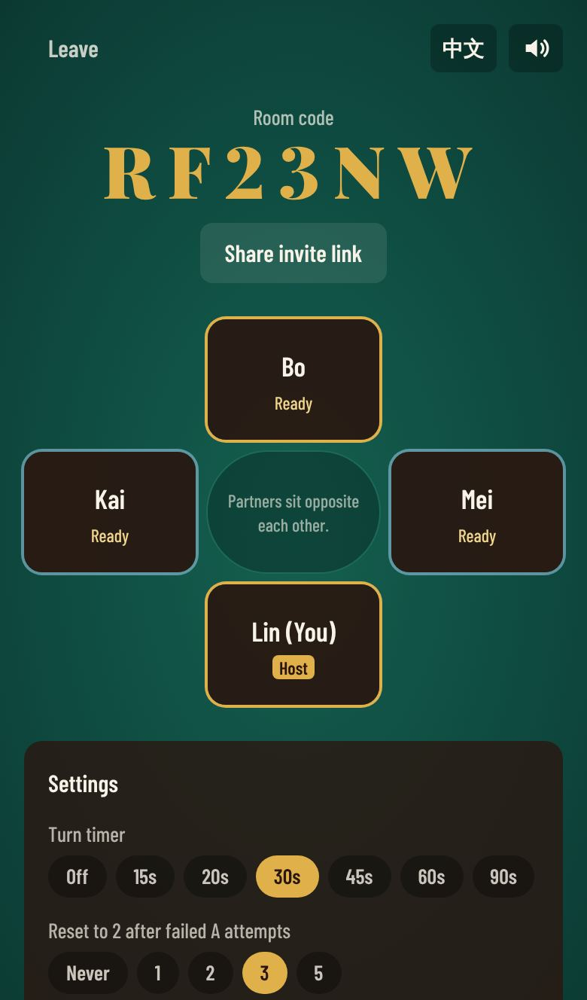

# Guandan 掼蛋 — online multiplayer

A mobile-first web app for playing Guandan with friends (or bots).

<p>
  
  
</p>


| Package   | What it is                                                     |
| --------- | -------------------------------------------------------------- |
| `shared/` | Types and the pure rules engine, used by both server and client |
| `server/` | Node + TypeScript + Socket.IO authoritative game server          |
| `client/` | React + Vite + TypeScript + Tailwind front end                   |
| `e2e/`    | Playwright test: 4 browsers play a full hand                     |

Rules as implemented: [docs/RULES.md](docs/RULES.md). Socket protocol: [docs/PROTOCOL.md](docs/PROTOCOL.md).

## Quick start

```bash
npm install
npm run dev        # server on :3001, client on :5173 (proxied)
npm test           # Vitest unit tests (rules, server, client helpers)
npm run typecheck  # tsc across all packages
npm run e2e        # Playwright: 4 browser contexts play a full hand
```

Open <http://localhost:5173>, create a room, and open the invite link in three more
tabs (or on phones on the same Wi-Fi: `http://<your-computer-ip>:5173`).

Copy `.env.example` to `.env` if you need to change ports or origins.

## How to play in the app

* **Create a room**, share the link or the 6-character code, pick a seat (partners sit
  opposite), ready up; the host starts when all four seats are filled.
* **Tap** cards to select them, or **drag across** cards to select a run. **Hint** cycles
  through legal plays, lowest first. If wild cards make a selection ambiguous you are
  asked which combo you mean.
* The ring around a player's avatar is their turn timer (30 s by default; the host can
  change it). When it runs out the game passes for you, or plays your lowest single when
  you are leading.
* From the second hand the loser(s) pay tribute: highlighted cards are the ones you are
  allowed to give or return.
* Reloading or losing signal is fine: you get your seat back automatically within 2
  minutes (after that, the server keeps playing for you until you return).
* 中文 / EN and sound toggles are in the top bar.
