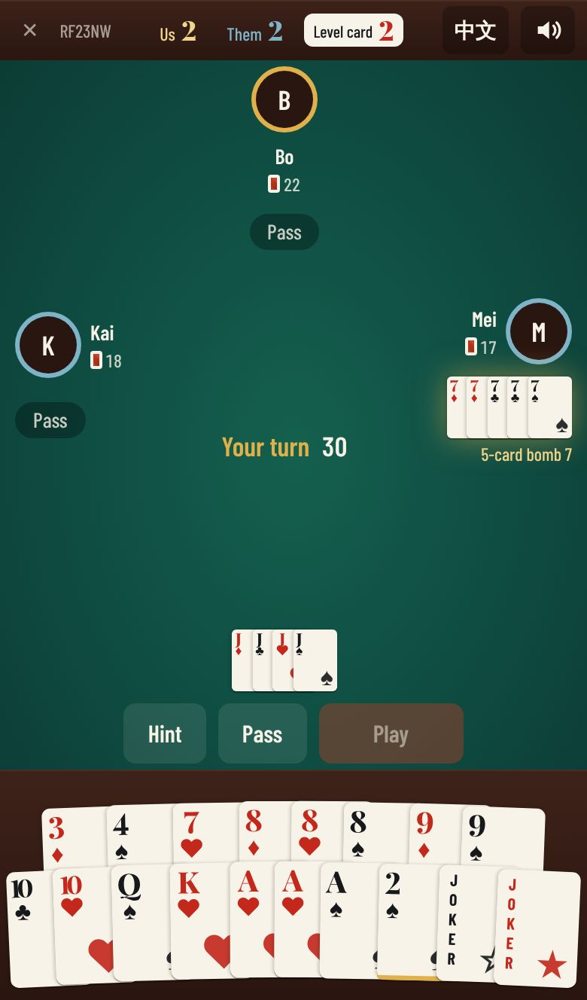
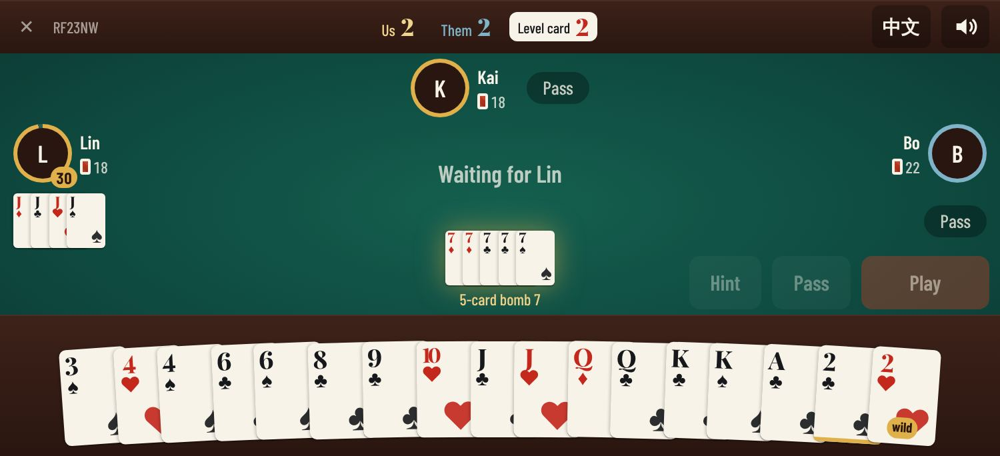

# Guandan 掼蛋 — online multiplayer

A mobile-first web app for playing Guandan with friends (or bots).

<p>
  
  
</p>


| Package   | What it is                                                     |
| --------- | -------------------------------------------------------------- |
| `shared/` | Types and the pure rules engine, used by both server and client |
| `server/` | Node + TypeScript + Socket.IO authoritative game server          |
| `client/` | React + Vite + TypeScript + Tailwind front end                   |
| `e2e/`    | Playwright test: 4 browsers play a full hand                     |

Rules as implemented: [docs/RULES.md](docs/RULES.md). Socket protocol: [docs/PROTOCOL.md](docs/PROTOCOL.md).

## Quick start

```bash
npm install
npm run dev        # server on :3001, client on :5173 (proxied)
npm test           # Vitest unit tests (rules, server, client helpers)
npm run typecheck  # tsc across all packages
npm run e2e        # Playwright: 4 browser contexts play a full hand
```

Open <http://localhost:5173>, create a room, and open the invite link in three more
tabs (or on phones on the same Wi-Fi: `http://<your-computer-ip>:5173`).

Copy `.env.example` to `.env` if you need to change ports or origins.

## Bots

`shared/src/bot.ts` is a simple, deterministic policy: go out if one play empties the
hand; lead the lowest combo without breaking bombs or spending wilds; follow opponents
with the lowest non-bomb that beats them; keep bombs unless the opponent is close to
going out; pass on the partner's play unless an opponent is about to go out. In tests
it wins ~95% of hands against a naive "lowest card" player.

## How to play in the app

* **Create a room**, share the link or the 6-character code, pick a seat (partners sit
  opposite), ready up; the host starts when all four seats are filled.
* **Playing alone?** The host can add a bot to any empty seat, or tap *Fill empty seats
  with bots*. A friend who joins later takes over a bot's seat in the lobby.
* **Tap** cards to select them, or **drag across** cards to select a run. **Hint** first
  suggests what a bot would play (lowest sensible play, bombs kept intact), then cycles
  through every other legal play. If wild cards make a selection ambiguous you are
  asked which combo you mean.
* The ring around a player's avatar is their turn timer (30 s by default; the host can
  change it). When it runs out the game passes for you, or plays your lowest single when
  you are leading.
* From the second hand the loser(s) pay tribute: highlighted cards are the ones you are
  allowed to give or return.
* Reloading or losing signal is fine: you get your seat back automatically within 2
  minutes (after that, the server keeps playing for you until you return).
* 中文 / EN and sound toggles are in the top bar.

## Deploy (Render + Vercel)

The **server** runs on [Render](https://render.com) (it needs a long-running process with
WebSockets) and the **client** is a static site on [Vercel](https://vercel.com). Both
deploy straight from this GitHub repo, and both have free plans. Everything below works
from a phone browser.

> Do this **after the PRs are merged into `main`**: `render.yaml` and `vercel.json`
> need to be on the default branch.

### Environment variables

| Where  | Variable          | Example                                  | What it does |
| ------ | ----------------- | ---------------------------------------- | ------------ |
| Render | `CLIENT_ORIGIN`   | `https://guandan.vercel.app`             | Browser origins allowed to connect. Comma-separate several; `*` works inside a host, e.g. `https://guandan-*.vercel.app` for preview deploys. Empty = allow any. |
| Render | `NODE_VERSION`    | `22`                                     | Already set by `render.yaml`. |
| Render | `PORT`            | *(set by Render)*                        | Don't set it yourself. |
| Render | `BOT_DELAY_MS`    | `900`                                    | Optional: bot think time in ms. |
| Vercel | `VITE_SERVER_URL` | `https://guandan-server.onrender.com`    | URL of the Render server, **no trailing slash**. Read at build time, so redeploy after changing it. |

No secrets are needed. Never commit a real `.env`; `.env.example` lists the names.

### 1 · Server on Render (about 5 minutes)

1. Open **dashboard.render.com** and sign in with **GitHub**.
2. Tap **New +** → **Blueprint**.
3. If asked, connect GitHub and give Render access to **wishang06/guandan**
   ("Only select repositories" is fine).
4. Pick the **guandan** repo. Render reads `render.yaml` and shows one web service,
   **guandan-server**. It asks for `CLIENT_ORIGIN`: **leave it empty for now** (if it
   won't let you, enter `https://*.vercel.app` — any Vercel site — and tighten it in
   step 3).
5. Tap **Apply** / **Deploy Blueprint** and wait until the service shows **Live**
   (the first build takes a few minutes).
6. Open the service and copy its URL, e.g. `https://guandan-server.onrender.com`.
   Check it in the browser: `https://…onrender.com/health` should show `{"ok":true,…}`.

### 2 · Client on Vercel (about 3 minutes)

1. Open **vercel.com/new** and continue with **GitHub**.
2. Find **wishang06/guandan** and tap **Import** (install the Vercel GitHub app for the
   repo if it asks).
3. On *Configure Project*: keep **Root Directory** as `./` and don't change the build
   settings — `vercel.json` sets them (Vite, `client/dist`).
4. Open **Environment Variables** and add `VITE_SERVER_URL` = the Render URL from step 1.6.
5. Tap **Deploy**. When it finishes, copy your domain, e.g. `https://guandan.vercel.app`
   (Project → **Domains**).

### 3 · Lock the server to your site

1. Back in Render: **guandan-server** → **Environment** → set `CLIENT_ORIGIN` to your
   Vercel domain (optionally add `,https://guandan-*.vercel.app` for preview deploys).
2. **Save changes**. Render redeploys on its own.

### 4 · Play

Open your Vercel URL on your phone, create a room and share the invite link. Tip: use
**Share → Add to Home Screen** to get a full-screen app icon.

### Good to know

* **Free Render services sleep** after ~15 minutes without traffic. The first visit then
  takes up to a minute; the app shows "the server is waking up". A paid instance avoids
  this.
* **Rooms live in memory.** A redeploy or restart ends games in progress. Merging a PR
  that only touches `client/` doesn't redeploy the server (`buildFilter` in
  `render.yaml`), and server-only changes don't rebuild the client (`ignoreCommand` in
  `vercel.json`).
* Changed `VITE_SERVER_URL`? Vercel → **Deployments** → ⋯ → **Redeploy**.
* Pushes to `main` deploy automatically on both services; Vercel also builds a preview
  for every PR.
