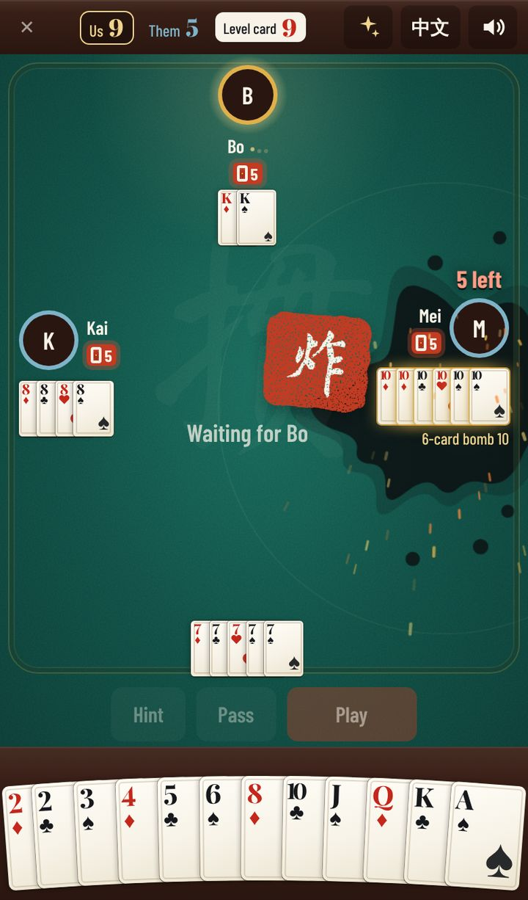
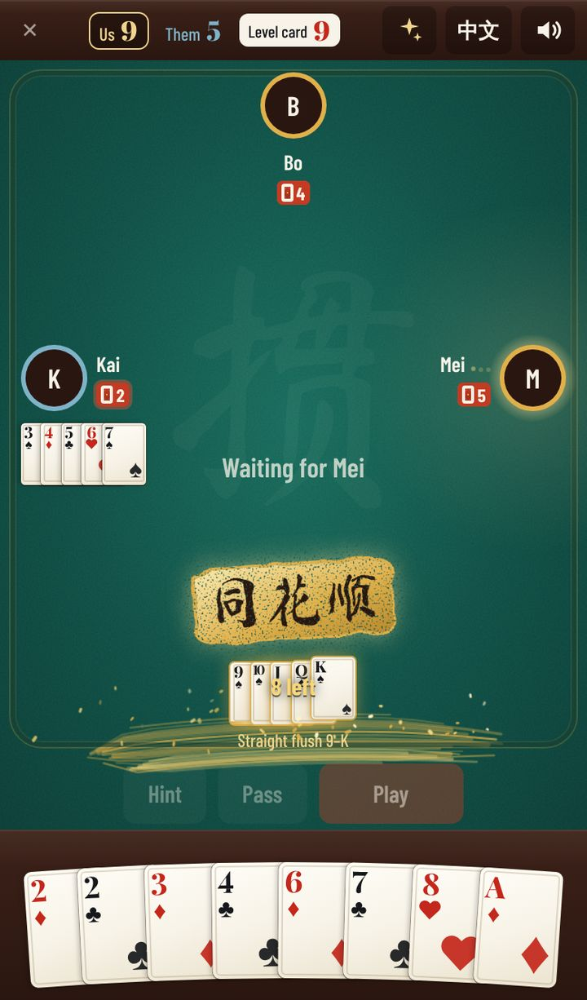
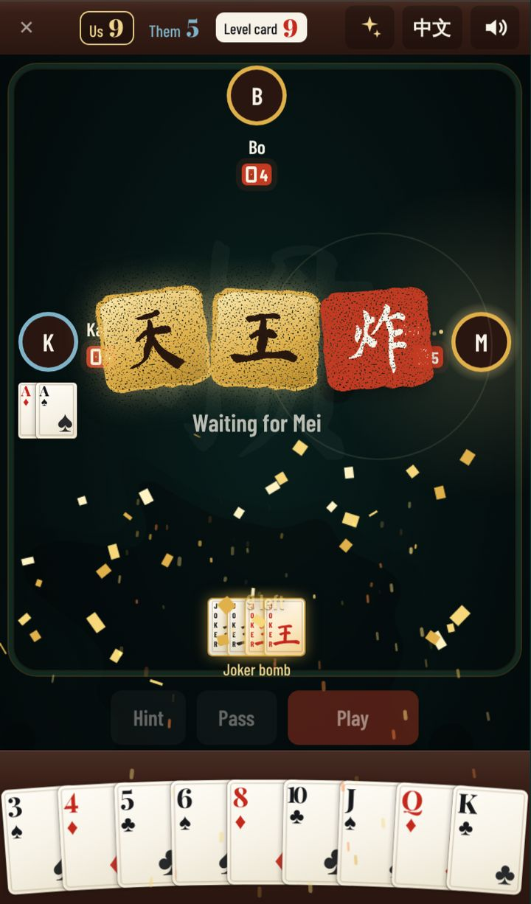
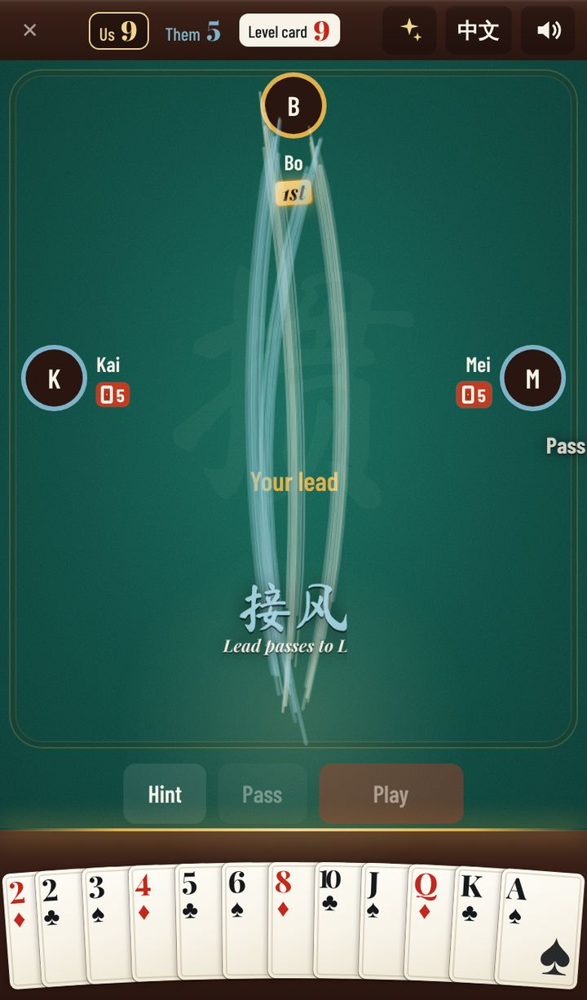

# Visuals, effects and animation

The look is built from three materials: **ink**, **gold leaf** and **cinnabar seals**
(墨 · 金 · 印). Routine plays stay quiet so the cards are always readable; the rare
moments get a set-piece that is brushed, stamped or struck rather than flashed in neon.

  
  
  
  

**See everything without waiting for the right cards:** open the app and tap *Preview
the effects* on the home screen (or add `?showcase` to the URL). It replays scripted
moments on the real table with no server, and the bots keep playing afterwards.

## What happens when

| Moment | What you see | Sound |
| ------ | ------------ | ----- |
| Deal | Your cards fly from a deck face down and flip in a wave; backs fly to the other seats; the level rank is brushed across the felt (打 9) | Riffle |
| Single / pair / triple | Cards fly from your hand (or the player's seat) and land with a puff of dust | Slide and slap |
| Full house, straight, three pairs, two triples | The same, plus the name brushed beside the cards; runs ripple and get an ink underline | Brush (a clang for 钢板) |
| Bomb of 4–5 | Cards **lift, hang, then slam**; ink splash, spark burst, shockwave ring, screen shake, a cinnabar 炸 seal | Whoosh, slam |
| Bomb of 6 / 7+ | Bigger ink, more rings and sparks, rising embers, a soft flash, a bigger seal | Boom |
| Straight flush | A gold dry-brush stroke under the run, sparks along it, gold 同花顺 seal | Slam + pentatonic bells |
| Four jokers | The felt goes dark (cards stay lit), lightning strikes, then 天 · 王 · 炸 are stamped one by one in gold leaf | Thunder |
| Trick won | The trick's cards are swept to the winner | – |
| Going out | 上游 / 二游 / 三游 / 下游 brushed beside the player and stamped on their seat; gold burst for first place | Plucked notes |
| 接风 | Pale wind strokes sweep from the finished player to the partner | Whoosh |
| Tribute | The tribute card flies face up across the table (the return card face down) and drops into the hand, glowing | Whoosh, pluck |
| 抗贡 | A 抗贡 seal | Stamp + gong |
| Hand over | 双下 seal for a 1–2 finish, gong, result sheet with the order revealed row by row and the level counted up one rank at a time; gold-leaf confetti for the winners | Gong, win/lose phrase |
| Match won | Fireworks | Fanfare |

Around those: a pool of light follows whoever is to act, seats breathe while thinking,
card counts turn amber at 10 and pulse red at 5, your own timer runs along the top of
your tray, the last five seconds close in red with ticks, the Play button glows once
your selection is legal, and wild cards carry a foil sheen.

## Effect tiers

`client/src/fx/plan.ts` maps every combo to a tier (tested in `plan.test.ts`):

| Tier | Combos | Treatment |
| ---- | ------ | --------- |
| 0 | single, pair, triple | flight + dust |
| 1 | full house, straight, tube, plate | + brushed name |
| 2 | bomb of 4 or 5 | lift-and-slam, ink, sparks, ring, shake, seal |
| 3 | bomb of 6, straight flush | bigger; embers / gold stroke |
| 4 | bomb of 7 or more | heavy slam, flash |
| 5 | four jokers | the full set-piece |

Intensity rises in the same order the rules rank bombs.

## How it is built

| File | Role |
| ---- | ---- |
| `fx/engine.ts` | Canvas engine: sparks, rings, ink blots, dry-brush strokes, lightning, confetti, fireworks. Two layers — one on the felt *behind* the cards, one in front of everything. The loop only runs while something is alive. |
| `fx/dom.ts` | Seals, brushed text, flashes, flying "ghost" cards, and sweeping removed cards away. |
| `fx/flight.ts` | FLIP bookkeeping: where your hand cards were, where seats are, which events are new. |
| `fx/director.ts` | Turns game events into staged moments (what, where, when). |
| `fx/plan.ts` | Pure mapping from combo to tier and intensity. |
| `fx/shake.ts` | Trauma-based screen shake (shake = trauma², smooth noise, linear decay). |
| `lib/sound.ts` | All sound is synthesised (no audio files), voiced on a pentatonic scale. |
| `demo/` | The effects preview and its scripted scenes. |

No animation library is used: card motion is the Web Animations API, particles are one
2D canvas. The brush font is a 34 KB subset of Ma Shan Zheng (SIL OFL) containing only
the glyphs the game uses — run `client/scripts/subset-brush-font.py` to add more.

The server helps the staging in two small ways: nobody acts for a moment after a deal
(`DEAL_PAUSE_MS`, 2.6 s) and bots take an extra beat before answering a bomb.

## Comfort and performance

* **Effects toggle** (✦ in the top bar): *reduced* turns off flights, particles, shake
  and flashes; seals and names simply fade in. It defaults to reduced when the device
  asks for reduced motion.
* Light never strobes: at most one soft pulse per event.
* Phones: the effects canvas is capped at 1.5× pixel density, sparks are budgeted,
  continuous animations (foil, glows, timers) run on the compositor, and seals are
  rasterised once. Haptics use the Vibration API where available (Android).
